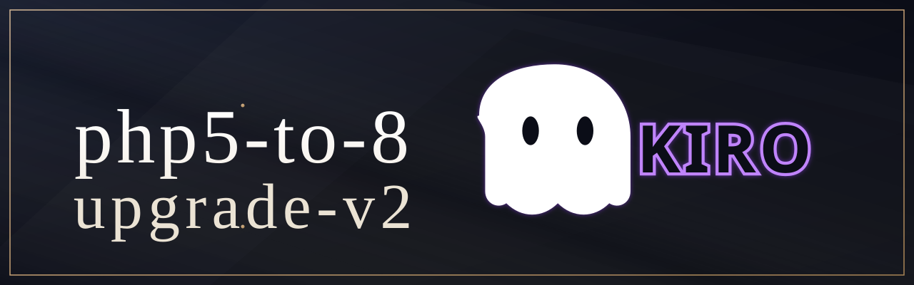
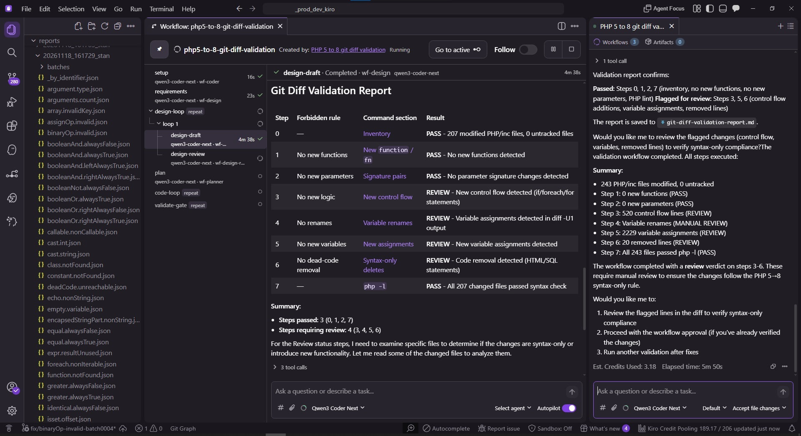

<div align="center">
  
</div>

## Modernize PHP without risking the business.

> [PHP2Shel](https://en.wikipedia.org/wiki/PHP2Shell) security risks are driving companies to upgrade, and php5-to-8-upgrade makes framework modernization as easy as a software update.

### Beneficiaries

php5-to-8-upgrade helps financial firms upgrade important old PHP systems in 3 days. Subagents provide 3× engineering capacity while keeping 100% of domain knowledge and systems stable.

## 1.0 Install
- PHP install [v8.5.12-1 VS17 x64 Non Thread Safe](https://downloads.php.net/~windows/releases/archives/php-8.5.12-1-nts-Win32-vs17-x64.zip)
- Composer install [v2.11.2 64-bit installer](https://getcomposer.org/download/)
- CodeGraph install [v1.6.2 win32-x64 zip](https://github.com/colbymchenry/codegraph/releases/download/v1.6.2/codegraph-win32-x64.zip)
- Git CLI install [v2.56.0.4 64-bit installer](https://github.com/git-for-windows/git/releases/download/v2.56.0.windows.4/Git-2.56.0.4-64-bit.exe)

## 2.0 Setup

- CMD: Run `composer install`

- Copy [codegraph.mdc](https://github.com/colbymchenry/codegraph/blob/main/.cursor/rules/codegraph.mdc) to `.kiro/steering/rules`

- *Optional*: set which folders to modify in `tools/config_phpcs.xml`, `tools/config_phpstan.neon`, and `tools/config_rector.php`.

## 3.0 How to Use

<div align="center">
  
</div>

First, in Kiro Accept file changes: *Run: `@php5-to-8-upgrade-v2-workflow`*

Or run the same steps manually:
```bash
codegraph init --local-only    # 1 Build index
composer compat:report         # 2 Scan code
composer compat:phpcbf         # 3 Auto-fix issues
composer rector:report         # 4 Refactor code
composer stan:report           # 5 Review issues
```

Second, in Kiro Accept file changes: *Fix `reports\20261116_160358_stan\offsetAccess.nonOffsetAccessible.json` using `@php5-to-8-upgrade-v2`*

Finally, in Kiro Accept file changes: *Git diff validate using `@php5-to-8-upgrade-v2`*

## 4.0 Modify Rules to Add a New PHP 8.5 Upgrade Example

In Kiro Accept file changes:

1/ Run `codegraph sync`. Use `codegraph_explore` to find all uses of *mysql_** and *split()*.

2/ Check `@php5-to-8-upgrade-v2` for the correct fixes.

3/ Use `@kiro-extension-author` to add a *split()* to *explode()* example in `@upgrade-sample-code.md`.

---
[Kenny Chan](https://www.linkedin.com/in/kennychenkk/)

Drive macro returns across market cycles through systematic signals and high-conviction risk allocation.
